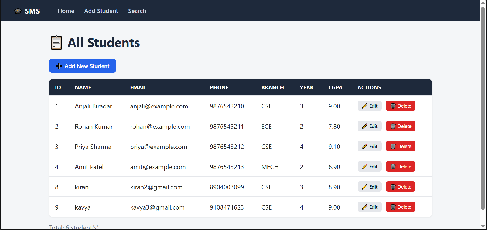
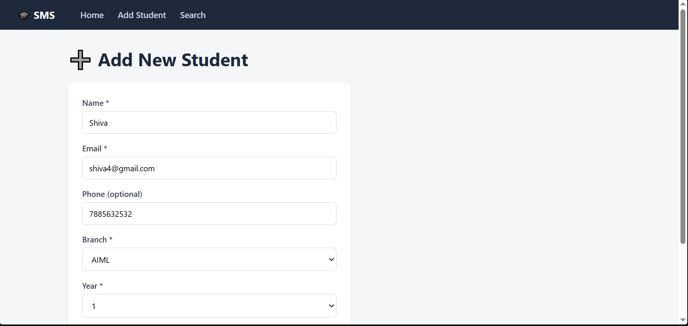
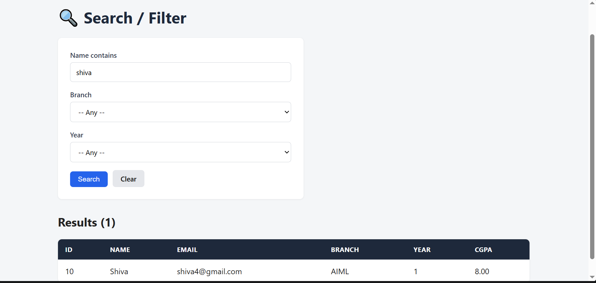
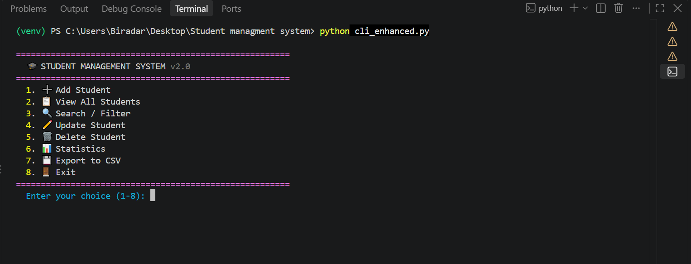
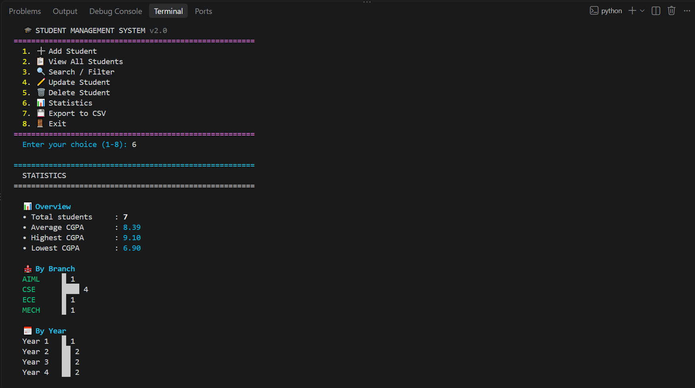

# 🎓 Student Management System

A full-stack student record management application built with **Python, Flask, and MySQL**. Supports complete CRUD operations, multi-criteria search, and a clean interactive interface.

## ✨ Features

- ✅ **Full CRUD** — Create, Read, Update, Delete student records
- 🔍 **Search & Filter** — by name (partial), branch, and year
- 🛡️ **Input Validation** — email format, phone length, CGPA range, branch whitelist
- 🔒 **SQL Injection Safe** — parameterized queries throughout
- 🖥️ **Two Interfaces** — Command-line (with colors & stats) and Web (Flask)
- 📊 **Statistics** — average CGPA, branch distribution, year breakdown
- 💾 **CSV Export** — dump all students to a spreadsheet
- 🔗 **Relational Design** — foreign keys with `ON DELETE CASCADE`

## 🛠️ Tech Stack

| Layer | Technology |
| ------- | ------------ |
| Language | Python 3.10+ |
| Web Framework | Flask |
| Database | MySQL 8.0 |
| DB Driver | mysql-connector-python |
| CLI Colors | colorama |
| Environment | venv |

## 📁 Project Structure

## 📸 Screenshots

### 🏠 Home — All Students

### ➕ Add Student Form

### 🔍 Search & Filter

### 🖥️ Enhanced CLI

### 📊 Statistics View

